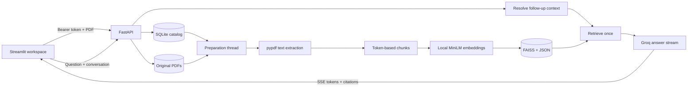

# Papertrail · PDF chat

Ask questions about your PDFs, read streamed answers, and open the exact passage behind each citation. Papertrail combines a Streamlit workspace with a FastAPI backend, local sentence embeddings, FAISS retrieval, and Groq chat models.

[Quick start](#quick-start) · [Architecture](#how-it-works) · [Configuration](#configuration) · [API](#api-reference) · [Tests](#testing) · [Troubleshooting](#troubleshooting)

## What you can do

- **Attach a PDF and a question together.** Preparation runs in the background; your question waits until the document is ready.
- **Keep a document library and saved conversations.** Browser storage restores your workspace; a recovery code opens it on another device.
- **Follow up naturally.** Conversation context helps resolve questions such as “Explain that date.”
- **Inspect the evidence.** Answers cite numbered passages. Inline links identify the answer, passage and physical PDF page, including multiple passages on one page.
- **Find older chats.** Recent conversations appear in the sidebar; “All saved conversations” supports search and pages of history.
- **Recover from interruptions.** Retry failed preparation or answers; completed request IDs replay their saved result.
- **Copy answers, export chats and download originals.** The PDF preview uses vendored PDF.js assets without a third-party CDN.

Searchable PDFs are supported. Scanned documents need OCR before upload. Defaults are **25 MiB per PDF**, **300 pages**, and **4 passages per question**.

## Quick start

### Requirements

- **Python 3.12**, including `venv` and pip. This is the tested Python version.
- A [Groq API key](https://console.groq.com/keys) for answers. Uploads and PDF previews work without a key.
- Internet access for the initial dependency/model download and for generated answers. Embeddings run locally on CPU; no GPU, OpenAI key or external vector database is required.

### Install and launch

```bash
git clone https://github.com/Abu-Sarfaraz/RAG-Based-Pdf-to-query-using-FastAPI-and-LangChain.git
cd RAG-Based-Pdf-to-query-using-FastAPI-and-LangChain
cp .env.example .env
```

Edit `.env`:

```dotenv
CHAT_API_KEY=your_groq_key
LLM_MODEL=llama-3.3-70b-versatile
```

Then run with Python 3.12:

```bash
python3.12 setup_backend.py
```

Open **http://localhost:8501**. The API documentation is at **http://localhost:8000/docs**. Attach a PDF, enter a question, then select a citation to inspect its page and passage.

The launcher creates separate `backend/.venv` and `frontend/.venv` environments, installs CPU PyTorch and pinned direct dependencies, waits for backend readiness, and starts both services. Existing `.env` files are preserved. The first launch downloads `sentence-transformers/all-MiniLM-L6-v2`; later launches reuse its model cache. Press **Ctrl+C** to stop both services.

For installation without starting services:

```bash
python3.12 setup_backend.py --install-only
```

On systems where `python3` already means Python 3.12, it can replace `python3.12`. On Windows, use `py -3.12 setup_backend.py`; copy `.env.example` with PowerShell's `Copy-Item` or your file manager.

### Start services separately

After installation, from the repository root, use separate terminals:

```bash
cd backend
.venv/bin/python -m uvicorn app.main:app --host 127.0.0.1 --port 8000 --workers 1
```

```bash
cd frontend
BACKEND_URL=http://localhost:8000 .venv/bin/python -m streamlit run app.py --server.address 127.0.0.1 --server.port 8501
```

Windows environments use `.venv\Scripts\python.exe`. In PowerShell, set `$env:BACKEND_URL = "http://localhost:8000"` before starting the frontend.

## How it works



1. A random workspace token authenticates document and conversation access. SQLite stores its hash.
2. Uploads are authenticated before multipart parsing. Actual received bytes are limited even when `Content-Length` is absent or inaccurate; multipart overhead has a separate 1 MiB allowance. The file itself still has the configured PDF limit.
3. A SHA-256 digest deduplicates uploads **within the workspace**. Failed/interrupted uploads can be requeued by uploading the original again.
4. One preparation thread reads the PDF and splits its text into overlapping token chunks. A shared CPU embedding model creates the vectors.
5. Index files are written to a temporary version and published by directory rename. Metadata is JSON; the application does not deserialize pickle files.
6. Each question retrieves passages once. Follow-ups may first use a separate model call to rewrite the search question. The answer streams from Groq, with a prompt restricting factual evidence to retrieved passages.
7. The catalog saves questions, answers, sources and timing metrics. A conversation lock prevents overlapping submissions from overwriting records. Index construction runs outside the cache lock so ready documents remain usable during preparation.

Preparation states are `uploading → queued → reading → preparing → ready`, with `failed` recording an actionable error. On restart, incomplete preparation is requeued. A saved original from an interrupted upload is recovered; an absent original requires reuploading.

## Repository layout

```text
backend/
  app/
    config.py          Environment loading and pipeline identity
    catalog.py         Workspace, document and chat persistence
    middleware.py      Upload authentication and actual body-byte limits
    embeddings.py      Shared CPU embedding model
    db.py              FAISS persistence and bounded LRU cache
    ingestion.py       PDF validation and durable preparation worker
    rag_chain.py       Follow-up resolution, retrieval and cited streaming
    main.py            API routes and application lifecycle
  tests/               Deterministic API, concurrency and fixture regressions
frontend/
  app.py               Streamlit library, chat, recovery and citations
  api.py               HTTP/SSE client and friendly connection errors
  components/          Browser storage, copy action and PDF.js viewer
  tests/               UI state and citation regressions
scripts/
  browser_check.py     Desktop/mobile browser workflow
  evaluate.py          Optional seven-question live provider evaluation
docs/
  ISSUE_REVIEW.md      Original bug reproductions and current resolution status
  VALIDATION.md        Verification results and practical limits
  ci-regressions.yml.example  Ready-to-enable GitHub Actions workflow
setup_backend.py
docker-compose.yml
render.yaml
```

## Configuration

Copy `.env.example` to `.env`. The backend loads the repository-root file; existing process environment variables take precedence. Never commit provider keys or workspace recovery codes.

| Variable | Default | Purpose |
| --- | --- | --- |
| `CHAT_API_KEY` | Empty | Groq key for generated answers. |
| `GROQ_API_KEY` | Empty | Fallback when `CHAT_API_KEY` is unset. |
| `LLM_MODEL` | `llama-3.3-70b-versatile` | Groq model identifier; it must be available to your account. |
| `EMBEDDING_MODEL` | `sentence-transformers/all-MiniLM-L6-v2` | Local embedding model. Changing it rebuilds stored indexes on restart. |
| `DATA_DIR` | `<repository>/.data` | Directory holding all persistent application data. |
| `MAX_UPLOAD_MB` | `25` | PDF file limit in MiB; multipart overhead is additional. |
| `MAX_PDF_PAGES` | `300` | Maximum physical page count. |
| `EMBEDDING_THREADS` | `2` | CPU threads used by PyTorch. |
| `ALLOWED_ORIGINS` | `http://localhost:8501` | Comma-separated origins for direct browser API requests. CORS does not replace workspace authentication. |
| `BACKEND_URL` | `http://localhost:8000` | Frontend process environment variable; set it when launching Streamlit. |
| `PORT` | `8000` / `8501` | Container startup port for backend / frontend. |

The `Settings` dataclass also sets chunk size (`220` tokens), overlap (`32`), cached indexes (`4`) and answer timeout (`90` seconds). These currently have no environment-variable overrides. Chunking/model changes alter the pipeline identity and trigger rebuilding.

Streamlit separately caps uploads at 25 MB in `frontend/.streamlit/config.toml`. If increasing the backend limit, adjust Streamlit and any reverse-proxy body limits too. Restart services after changing configuration. For a custom embedding model in Docker, update the build configuration and rebuild the model cache before enabling offline runtime.

## Storage, recovery and privacy

```text
.data/
├── .backend.lock          # enforces one backend process
├── catalog.sqlite3        # workspace hashes, documents, jobs, chats and metrics
├── catalog.sqlite3-wal    # may exist while SQLite is running
├── catalog.sqlite3-shm
├── uploads/<id>.pdf       # original PDFs, named with opaque IDs
└── indexes/<id>/<version>/
    ├── index.faiss
    └── documents.json
```

Run **one Uvicorn worker and one backend instance per data directory**. A process lock rejects a second instance. Use persistent storage in containers or hosted environments. Changing `DATA_DIR` points the application at a different library.

The browser stores the workspace token in local storage, scoped to the backend URL. The API keeps only its hash. Save the recovery code under **Workspace & recovery** before clearing browser storage, changing browser/device, or changing the frontend origin. Anyone with that code can access its workspace; there is no password reset or account recovery service.

PDF extraction, embedding and indexing happen locally. Questions, retrieved excerpts and recent conversation context are sent to Groq to generate answers. Originals and saved chat data remain on the application's storage. PDF.js is served locally. Documents are isolated by workspace but storage is not encrypted by this application.

For a backup, stop the backend and copy the **entire data directory** to protected storage; also keep the recovery codes separately. Restore the directory, permissions, model configuration and `DATA_DIR` together before restarting. Copying only the SQLite file while it is running can omit uncheckpointed WAL data.

Deleting a ready/failed document removes its original, indexes and conversations. Deletion waits for active preparation/answers to finish. Legacy `backend/.faiss_index` files have no ownership catalog and are not imported; upload those PDFs into the new library.

## API reference

`POST /workspaces` and `GET /health` are public. All other application routes require `Authorization: Bearer <workspace-token>`.

| Method | Path | Result |
| --- | --- | --- |
| `GET` | `/health` | Startup readiness, configured answer-service flag and PDF limits. |
| `POST` | `/workspaces` | `201`: new workspace ID and recovery token. |
| `GET` | `/workspace` | Documents, up to 40 recent conversations, limits and configuration flags. |
| `GET` | `/documents` | Workspace's document library. |
| `POST` | `/documents` | `202`: multipart field `file`; queued or deduplicated document. |
| `GET` | `/documents/{id}` | Preparation state, page/chunk counts, suggestions and errors. |
| `GET` | `/documents/{id}/file` | Authorized original PDF, with private/no-store cache headers. |
| `POST` | `/documents/{id}/retry` | Requeue a failed document if its original is available. |
| `DELETE` | `/documents/{id}` | Remove document files and its conversation records. |
| `GET` | `/conversations` | History; `limit=1..100` (default 40), `offset>=0`, optional `search` in titles/filenames. |
| `POST` | `/conversations` | `201`: conversation for a ready `document_id`. |
| `GET` | `/conversations/{id}` | Conversation and saved messages, sources and metrics. |
| `POST` | `/conversations/{id}/messages` | SSE stream; `question`, optional `k=1..12` and `request_id`. |

Questions must contain 1–4,000 characters after validation. Document and client-supplied request IDs use 32 lowercase hexadecimal characters. Typical errors are `400` for invalid files, `401` for missing/invalid workspace tokens, `404` for missing or another workspace's resources, `409` for busy/incompatible operations, `413` for size limits and `422` for invalid request fields.

### Try the API

Create a workspace and save the returned token privately:

```bash
curl -sS -X POST http://localhost:8000/workspaces
```

Set the token in your shell and upload a PDF:

```bash
export WORKSPACE_TOKEN='paste-the-returned-token'
curl -sS http://localhost:8000/documents \
  -H "Authorization: Bearer $WORKSPACE_TOKEN" \
  -F 'file=@demo.pdf;type=application/pdf'
```

Use the returned document ID to poll `GET /documents/{id}` until `status` is `ready`. Then start a conversation:

```bash
curl -sS http://localhost:8000/conversations \
  -H "Authorization: Bearer $WORKSPACE_TOKEN" \
  -H 'Content-Type: application/json' \
  -d '{"document_id":"replace_with_document_id"}'
```

Use its conversation ID to stream an answer (`-N` disables curl buffering):

```bash
curl -N http://localhost:8000/conversations/CONVERSATION_ID/messages \
  -H "Authorization: Bearer $WORKSPACE_TOKEN" \
  -H 'Content-Type: application/json' \
  -d '{"question":"What are the main findings?","k":4}'
```

### Streaming and retries

Each SSE record is a JSON object preceded by `data: ` and followed by a blank line:

```text
data: {"event":"status","message":"Finding relevant passages"}

data: {"event":"sources","sources":[...]}

data: {"event":"token","text":"The main finding"}

data: {"event":"done","answer":"...","sources":[...],"cited_source_ids":[1],"metrics":{...}}
```

A failure after streaming starts is an `error` event; HTTP status alone does not establish success. A complete answer requires `done`. Treat `done.answer` as authoritative because final citation validation can remove invalid numeric citation IDs from the earlier token stream.

For safe retries, generate a UUID hex request ID and reuse it with the **same question**. Completed requests replay saved content without another model call. Failed requests can be regenerated without duplicate user/assistant records. A reused ID with a different question returns `409`; another active submission in the same conversation also returns `409`.

The hidden `/ingest` alias accepts the current authenticated upload contract. The former unauthenticated `/ask` and collection-name API are no longer supported.

## Docker and hosting

Copy/configure `.env` first, then:

```bash
docker compose up --build
```

The backend image installs CPU PyTorch and preloads the embedding model. Model downloads are disabled at runtime. The frontend waits for backend health. Both container commands use `exec` so the application receives shutdown signals and expands the hosting provider's `PORT` value.

The `papertrail-data` named volume mounts at `/data`. `docker compose down` preserves it; **`docker compose down --volumes` deletes its data**. Initial builds require network access and can take time due to PyTorch and embedding-model downloads.

The Render blueprint runs both services through Docker and configures a persistent backend disk. It declares a paid backend plan; review the hosting provider's current costs before applying it. Set backend `CHAT_API_KEY`, then frontend `BACKEND_URL` to the backend's HTTPS URL. No deployment is created by cloning or running tests.

The current workspace token design is suitable for a trusted/private installation. Workspace creation is open, and total storage, answer usage and ingestion rates do not have application quotas. Restrict admission and apply quotas/rate limits at your hosting boundary before opening an instance funded by your provider key to the public. Multiple backend replicas require shared ownership/chat storage, object storage and coordinated retrieval/job processing first.

## Testing

The default checks use synthetic PDFs, deterministic embeddings/model responses, and temporary storage. They do not spend provider credits or load production documents.

### Backend regressions

```bash
cd backend
.venv/bin/python -m pip install -r requirements-dev.txt
.venv/bin/python -m unittest discover -s tests -t . -v
```

Coverage includes workspace isolation, PDF errors, deduplication, disk-index restoration, streaming, follow-ups, retry/replay, concurrent submissions, actual multipart byte limits and cleanup, concurrent preparation/retrieval, older history and restart recovery.

### Frontend state checks

From the repository root, no additional packages are needed:

```bash
python3 -m unittest discover -s frontend/tests -v
```

These exercise the real UI function bodies in an isolated state harness: stale retries, workspace/document switching, exact citation resolution, old deep links and reuploads.

### Desktop/mobile browser checks

Install browser-test dependencies:

```bash
frontend/.venv/bin/python -m pip install -r frontend/requirements-dev.txt
frontend/.venv/bin/python -m playwright install chromium
```

Start the isolated backend from `backend`:

```bash
.venv/bin/python -m uvicorn tests.browser_server:app --host 127.0.0.1 --port 18000
```

Start the frontend from `frontend` in another terminal:

```bash
BACKEND_URL=http://127.0.0.1:18000 .venv/bin/python -m streamlit run app.py --server.address 127.0.0.1 --server.port 18501 --server.headless true
```

Then run from the root:

```bash
frontend/.venv/bin/python scripts/browser_check.py
```

Screenshots go to `/tmp/papertrail-browser-checks` by default; override with `--artifacts PATH`. The script checks real citation popups, combined upload/question, follow-ups, PDF navigation, refresh restoration and a 390 × 844 mobile viewport. The test backend is a fixture with fake models; use `app.main:app` for normal operation.

The [GitHub Actions template](docs/ci-regressions.yml.example) runs backend/state regressions and the browser workflow on pushes and pull requests, with browser screenshots and service logs as artifacts. To enable it, copy the template to `.github/workflows/ci.yml` and commit it using GitHub's web editor or credentials with workflow-file permission:

```bash
mkdir -p .github/workflows
cp docs/ci-regressions.yml.example .github/workflows/ci.yml
```

The template is not active while stored under `docs/`. Ordinary repository-write OAuth access may require the additional `workflow` scope to publish it.

### Optional live answer evaluation

```bash
backend/.venv/bin/python scripts/evaluate.py --live --output /tmp/papertrail-evaluation.json
```

This explicitly uses your configured Groq key for seven questions and a follow-up rewrite, with real local embeddings and temporary synthetic PDFs. It checks facts, expected cited pages, an unsupported question and isolation between documents. Provider availability, quotas and model behavior can affect results.

See [validation results](docs/VALIDATION.md) for what was actually run and [issue resolutions](docs/ISSUE_REVIEW.md) for bug-by-bug evidence. No test suite guarantees that all future model answers are correct; inspect the supporting excerpts.

## Troubleshooting

| Symptom | What to check |
| --- | --- |
| “Answer service needs to be connected” | Add `CHAT_API_KEY` to root `.env`, choose a model available to your Groq account, then restart the backend. `/health` only checks whether a key is configured; it does not verify it with Groq. |
| First startup appears slow | Dependencies and the embedding model download on first use. Read backend logs; ensure the model hub is reachable. |
| Model cannot load in an offline container | Build the image with network access first. A custom embedding model must also be downloaded at build time. |
| “Another backend is using this DATA_DIR” | Stop the existing backend and use `--workers 1`. Deleting the lock filename does not stop its owning process. |
| Upload rejected at a different size in the browser | Align backend `MAX_UPLOAD_MB`, Streamlit `maxUploadSize`, and reverse-proxy limits. |
| “No searchable text” | Run OCR/text recognition and export a searchable PDF. Image-only PDFs are not automatically transcribed. |
| Password-protected PDF | Export an unlocked copy before uploading. |
| Interrupted upload or failed preparation | Retry preparation if the original exists; otherwise reupload it. Reuploading identical bytes reuses the existing document and reschedules failed work. |
| Workspace disappeared after clearing storage | Restore its saved recovery code. Without that token there is no built-in recovery mechanism. |
| Old conversation missing from the sidebar | Use “All saved conversations”, search by title/filename, or open its saved chat URL in the same workspace. |
| Answer request failed or timed out | Retry the saved question. A busy/provider-limited service may need time; keep the same request ID for a failed API retry. |
| Frontend cannot reach backend | Set `BACKEND_URL` in the frontend environment. Inside Compose it is `http://backend:8000`, not the browser's localhost. |
| Poor or unsupported answers | Ask a narrower question, inspect the cited passage, or change “Passages to search”. Broad summaries and extracted tables may need more careful review. |

## Contributing

Use Python 3.12 and keep the two dependency environments separate. Reproduce behavior with a small synthetic fixture, add a regression for meaningful bug fixes, run the relevant checks above, and keep API/configuration documentation synchronized. Do not commit `.env`, `.data`, `.venv`, private PDFs, model caches or recovery codes.

OCR, hybrid retrieval/reranking and multi-instance storage are possible extensions; evaluate them against representative documents before changing the current pipeline.

The vendored PDF.js and font files include their upstream licenses under `frontend/components/pdf_viewer/vendor/`. The repository currently has no top-level project license; those third-party notices do not license the rest of the application.
